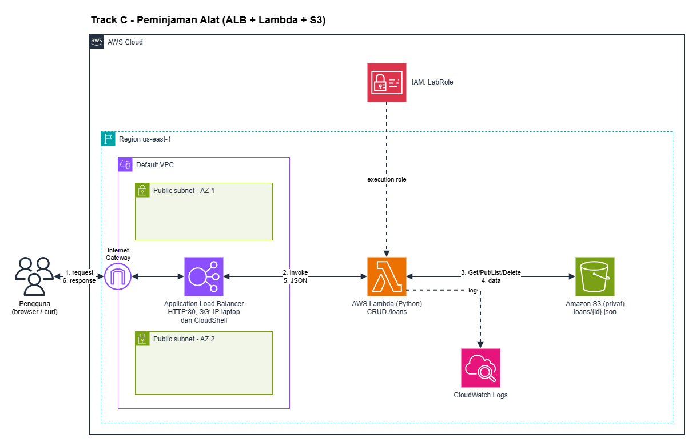

# Tugas Mata Kuliah Komputasi Awan Week 12: Design and AWS Setup

Nama: Violin Mulya Putra

NIM: 24/534192/TK/59201

Prodi: Teknologi Informasi

Track: C

# Equipment Loan Serverless

API peminjaman alat dengan arsitektur serverless di AWS (Track C).

## Arsitektur



Alur: request masuk ke ALB, diteruskan ke Lambda, Lambda membaca atau menulis data di S3, lalu respons JSON kembali lewat ALB.

## Layanan AWS

Region: `us-east-1`

| Layanan | Fungsi | Konfigurasi |
|---|---|---|
| Application Load Balancer | Pintu masuk HTTP | Internet-facing, default VPC, 2 subnet |
| AWS Lambda | Logika CRUD | `loan-app-fn`, Python 3.12, 128 MB, timeout 15 detik |
| Amazon S3 | Penyimpanan data | Bucket `loan-app-data-<account-id>`, Block Public Access aktif |
| Amazon EC2 (Security Group) | Pembatas akses ALB | Port 80 hanya dari IP laptop dan CloudShell |
| IAM | Izin Lambda | `LabRole` bawaan lab |
| CloudWatch Logs | Log Lambda | `/aws/lambda/loan-app-fn` |
| CloudFormation | Pembuatan resource | `template.yaml` |

## Alasan Pemilihan Layanan

| Contoh materi | Dipakai | Trade-off |
|---|---|---|
| API Gateway | Application Load Balancer | Routing HTTP sederhana, tetapi routing detail ditangani kode dan ALB memakai budget selama aktif |
| DynamoDB | Amazon S3 | Sederhana, tetapi tanpa query dan daftar data makin lambat jika objek bertambah |

## Data

Setiap peminjaman disimpan sebagai satu objek `loans/{id}.json`.

| Kolom | Keterangan |
|---|---|
| `id` | UUID, dibuat otomatis |
| `borrower_name` | Teks, maksimal 100 karakter |
| `equipment_name` | Teks, maksimal 100 karakter |
| `loan_date` | `YYYY-MM-DD` |
| `due_date` | `YYYY-MM-DD`, tidak boleh sebelum `loan_date` |
| `status` | `dipinjam` (default) atau `dikembalikan` |

## Daftar API

| Method | Path | Fungsi | Sukses |
|---|---|---|---|
| GET | `/health` | Cek aplikasi | 200 |
| GET | `/loans` | Daftar peminjaman | 200 |
| POST | `/loans` | Tambah peminjaman | 201 |
| GET | `/loans/{id}` | Detail peminjaman | 200 |
| PUT | `/loans/{id}` | Ubah sebagian atau seluruh kolom | 200 |
| DELETE | `/loans/{id}` | Hapus peminjaman | 200 |

Kode error: `400` input tidak valid, `404` data atau route tidak ditemukan, `405` method tidak diizinkan, `500` kesalahan server.

Contoh:

```bash
curl -X POST http://<DNS-ALB>/loans \
  -H "Content-Type: application/json" \
  -d '{"borrower_name":"Budi","equipment_name":"Proyektor","loan_date":"2026-11-26","due_date":"2026-11-30"}'
```

## Struktur Repo

```
.
├── src/index.py
├── template.yaml
├── deploy.sh
├── test.sh
├── cleanup.sh
├── docs/architecture.png
└── README.md
```

## Dependensi

- Python 3.12 dan `boto3` (tersedia di runtime Lambda)
- AWS CLI, `curl`, `zip`, `python3`, dan `git` (dijalankan di AWS CloudShell)

## Deployment

1. Start Lab, buka AWS Console, pilih `us-east-1`, lalu buka CloudShell.
2. Catat IP publik laptop dari `https://checkip.amazonaws.com`.
3. Jalankan:

```bash
git clone https://github.com/violinmulyaputra/equipment-loan-serverless.git
cd equipment-loan-serverless
bash deploy.sh <IP-laptop>
```

Skrip menampilkan alamat API setelah ALB siap. Jalankan ulang skrip jika IP laptop berubah.

## Pengujian

```bash
bash test.sh
bash test.sh persist
bash test.sh failure
```

| Perintah | Yang diuji |
|---|---|
| `bash test.sh` | CRUD, validasi input, dan penolakan akses publik ke S3 |
| `bash test.sh persist` | Data tetap ada setelah konfigurasi Lambda diperbarui |
| `bash test.sh failure` | Nama bucket disalahkan, error dicek di CloudWatch, lalu dipulihkan |

Log hasil pengujian tersimpan di folder `evidence/`.

## Cleanup

```bash
bash cleanup.sh
```

Skrip menghapus isi bucket, stack CloudFormation, dan log group Lambda. Jika pembuatan stack gagal, jalankan cleanup sebelum deploy ulang.

## Keamanan dan Keterbatasan

- API belum memakai autentikasi dan masih HTTP, sehingga akses dibatasi lewat security group.
- `LabRole` memiliki izin yang luas karena Sandbox tidak mengizinkan pembuatan role baru.
- Tidak ada kredensial yang disimpan di repo.
- Resource di Sandbox terhapus saat sesi berakhir.
